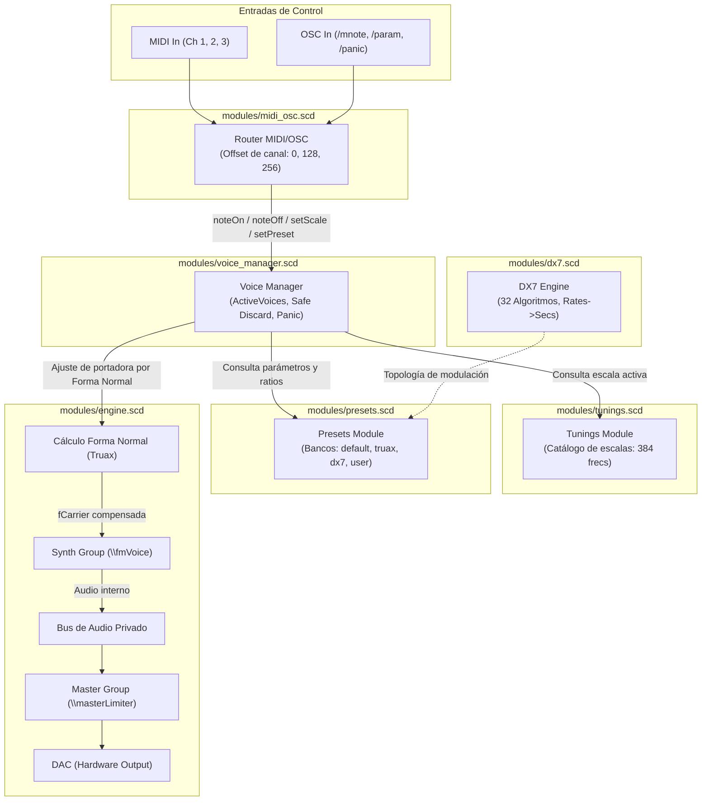

# diesisRosa

Sintetizador microtonal modular programado en SuperCollider. Combina afinaciones históricas y experimentales con un motor de modulación en frecuencia (FM) de tres operadores en cascada, matriz de 32 algoritmos canónicos de 6 operadores estilo Yamaha DX7, preservación psicoacústica de la fundamental (Forma Normal de Barry Truax) y control integral por MIDI multicanal y Open Sound Control (OSC).

---

## 1. Qué hace

El proyecto nació para superar la restricción de los doce semitonos del teclado convencional sin perder la estabilidad del sintetizador en vivo ni la coherencia armónica de la síntesis digital. En lugar de un script monolítico con variables globales dispersas y disparadores manuales, el código corre dividido en módulos desacoplados: motor de audio, tablas de cálculo de afinación, bancos de timbres, gestor de polifonía a prueba de fugas y receptores de control.

### Afinaciones disponibles

Cada escala calcula un arreglo canónico de **384 posiciones continuas de frecuencia** en Hertz, permitiendo mapear tres canales MIDI contiguos (hasta 384 teclas sin quiebres de registro ni notas repetidas):

- **tet12**: Temperamento igual estándar de 12 divisiones (referencia moderna).
- **tet31, tet41, tet53**: Temperamentos iguales extendidos (EDO / TET) de alta resolución armónica.
- **pitag53**: Escala pitagórica construida mediante 26 quintas y 26 cuartas puras acomodadas dentro de 53-EDO, con normalización estricta de octava.
- **meantone31**: Mesotónico de un cuarto de coma sintónica (Pietro Aron) organizado en 31-EDO.
- **magic41**: Temperamento Mágico en 41 notas por ciclo usando el generador $3^{1/5}$.
- **partch**: Sistema de 43 tonos en justa entonación de Harry Partch con frecuencia base en Sol 0 (24.5 Hz).
- **dalessandro**: Afinación de Erv Wilson construida sobre Do 4 = 256 Hz (diapasón científico).
- **centaur**: Escala de 12 grados de Kraig Grady en justa entonación de límite 7.

### Bancos de sonido FM

Los timbres están definidos en diccionarios desacoplados según relaciones de portadora y moduladores ($C:M$):

#### Timbres clásicos (`presets/default_presets.scd`)
- `\fmBell`: Campana inarmónica con proporciones de Chowning ($1 : 1.414 : 3.5$) y caída exponencial de brillo.
- `\fmBass`: Bajo sólido estilo TX81Z / LatelyBass con ataque percusivo rápido en el segundo modulador.
- `\fmElectricPiano`: Timbre de piano electromecánico con modulador agudo transitorio emulando la barra metálica.
- `\fmAtmospherePad`: Textura lenta con batimiento interno diseñada para acordes microtonales densos.
- `\fmHardLead`: Espectro cortante basado en armónicos impares ($1 : 3 : 5$).

#### Timbres de investigación acústica (`presets/truax_presets.scd`)
Basados en las técnicas de Barry Truax (*Simon Fraser University* / *Handbook for Acoustic Ecology*):
- `\truaxGong2_5`: Gong inarmónico con espaciamiento de bandas laterales asimétrico ($2C$ y $M-2C$).
- `\truaxChime3_7`: Campana de vidrio en familia $3:7$ con componentes reflejados en contrafase.
- `\truaxHollowReed`: Caña hueca basada en armónicos impares ($1:2$), balanceada para terceras puras en mesotónico o Centaur.
- `\truaxFormantVocal`: Región formántica vocal usando el miembro desplazado $3:1$ de la familia armónica.
- `\truaxWaterDroplet`: Modulación en la frontera de los 20 Hz, transitando entre pulso de gotas y tono continuo.

#### Módulo y parches Yamaha DX7 (`modules/dx7.scd` y `presets/dx7_presets.scd`)
Basado en *Chowning & Bristow (1986)* y el proyecto *DX7-Supercollider*. Modela los 32 algoritmos canónicos de 6 operadores con conversión logarítmica de envolventes y adaptación a afinaciones microtonales:
- `\dx7EPIANO`: Recreación del sonido icónico E.PIANO 1 (ROM 1A) con ataque metálico en armónico 14x.
- `\dx7BASS1`: Bajo seco percusivo clásico del DX7.
- `\dx7TUBBELLS`: Campanas tubulares sinfónicas con batimiento inarmónico.
- `\dx7MARIMBA`: Percusión de mazo de madera con decaimiento rápido.
- `\dx7BRASS1`: Sección de metales ochentera brillante.

---

## 2. Arquitectura Modular (`modules/`)

El sistema adopta una arquitectura desacoplada basada en eventos prototipo (`IdentityDictionary`) que se comunican a través del espacio de nombres principal `~diesisRosa`.



### Detalle de los 6 módulos

| Módulo | Archivo | Responsabilidad e Interfaz Pública |
| :--- | :--- | :--- |
| **Engine** | [`modules/engine.scd`](file:///Users/byron/Documents/diesisRosa-main/modules/engine.scd) | **Núcleo de audio**. Compila los `SynthDef` (`\fmVoice`, `\syncVoice`, `\masterLimiter`), reserva buses de audio estéreo privados, inicializa grupos de ejecución (`synthGroup`, `fxGroup`) y ejecuta el algoritmo matemático de **Forma Normal de Barry Truax** (`toNormalForm`, `calcCarrierFreq`). |
| **DX7** | [`modules/dx7.scd`](file:///Users/byron/Documents/diesisRosa-main/modules/dx7.scd) | **Emulación DX7**. Aloja la matriz de los 32 algoritmos canónicos de 6 operadores con sus pares de portadoras/moduladores y bucles de feedback reflexivo (`[n, n]`). Convierte tasas DX7 (0-99) a segundos mediante aproximación logarítmica (`rateToSeconds`) y niveles a amplitud cuadrática (`levelToAmp`). |
| **Voice Manager** | [`modules/voice_manager.scd`](file:///Users/byron/Documents/diesisRosa-main/modules/voice_manager.scd) | **Gestor polifónico seguro**. Asocia cada nota a una clave única `\chan_note` en `activeVoices`. Elimina fugas de nodos (*voice leaks*) enviando `gate: 0` antes de reinstanciar una misma nota. Consulta la frecuencia en `tunings`, compensa el carrier con `engine`, y provee pánico suave (`panicSoft`, `gate: 0`) y duro (`panicHard`, `freeAll`). |
| **Presets** | [`modules/presets.scd`](file:///Users/byron/Documents/diesisRosa-main/modules/presets.scd) | **Almacén de timbres**. Mantiene un `IdentityDictionary` en `bank`. Carga bancos desde archivos `.scd` (`loadBankFromFile`), almacena nuevos presets (`setPreset`), lista los disponibles (`listPresets`) y los serializa en arrays de argumentos listos para `Synth` (`asArgsArray`). |
| **Tunings** | [`modules/tunings.scd`](file:///Users/byron/Documents/diesisRosa-main/modules/tunings.scd) | **Catálogo microtonal**. Genera arreglos continuos de 384 frecuencias para 10 afinaciones históricas y temperamentos iguales (`buildAllScales`). Provee acceso por clave (`getScale`) con retorno por defecto seguro a `tet12`. |
| **MIDI / OSC** | [`modules/midi_osc.scd`](file:///Users/byron/Documents/diesisRosa-main/modules/midi_osc.scd) | **Enrutador de control**. Conecta todos los dispositivos MIDI (`MIDIClient`, `MIDIIn.connectAll`). Mapea los canales MIDI 0, 1 y 2 asignando desplazamientos continuos de nota (+0, +128, +256). Registra escuchas OSC (`/mnote`, `/param/a/octave`, `/param/scale`, `/param/preset`, `/allnotesoff`, `/allsoundoff`) y captura mensajes CC de pánico (CC 120 y CC 123). |

---

## 3. Motor de Síntesis FM y Sistema de Algoritmos

### Síntesis FM en cascada continua (3 operadores)

La síntesis de voz principal (`\fmVoice`) utiliza una cadena de tres osciladores sinusoidales en cascada:

$$\text{Modulador 2} \xrightarrow{i\_i_2} \text{Modulador 1} \xrightarrow{i_1} \text{Portadora (Carrier)} \rightarrow \text{Audio Out}$$

Cada operador dispone de su propia afinación relativa a partir de los ratios $c$, $m_1$ y $i\_m_2$.

#### Ecuaciones de modulación y envolventes

1. **Frecuencias de los operadores:**
   Dada la frecuencia base requerida $f_{\text{base}}$ y el vibrato $v(t) = \text{LFTri}(f_{\text{vib}}) \cdot a_{\text{vib}}(t)$:
   $$f_{\text{carrier}} = f_{\text{base}} + (v(t) \cdot \text{det})$$
   $$f_{m1} = f_{\text{carrier}} \cdot \left(\frac{m_1}{c}\right)$$
   $$f_{m2} = f_{m1} \cdot \left(\frac{i\_m_2}{c}\right)$$

2. **Modulación en cascada:**
   - La señal del **Modulador 2** modula la frecuencia instantánea del **Modulador 1**:
     $$A_{m2}(t) = (f_{\text{carrier}} \cdot \text{ratio}_{m1}) \cdot i\_i_2 \cdot \text{ADSR}_{m2}(t)$$
     $$M_2(t) = \sin(2\pi f_{m2} t) \cdot A_{m2}(t)$$
   - La señal resultante alimenta al **Modulador 1**, modulando la fase/frecuencia de la **Portadora**:
     $$A_{m1}(t) = f_{\text{base}} \cdot i_1 \cdot \text{ADSR}_{m1}(t)$$
     $$M_1(t) = \sin(2\pi (f_{m1} + M_2(t)) t) \cdot A_{m1}(t)$$
   - La señal de salida de la **Portadora** es esculpida por una envolvente **DADSR** con liberación automática del nodo:
     $$S(t) = \sin(2\pi (f_{\text{carrier}} + M_1(t)) t) \cdot \text{DADSR}_{c}(t)$$

> [!NOTE]
> La portadora implementa `Env.dadsr` con `doneAction: 2`. Cuando la envolvente de amplitud de la portadora llega a cero tras el release, el servidor de SuperCollider destruye inmediatamente el nodo del sintetizador, liberando los ciclos de CPU y garantizando la limpieza del servidor. Los moduladores emplean `Env.adsr` con `doneAction: 0`, permitiendo que su evolución tímbrica permanezca activa exactamente durante la duración de la nota sin destruir la voz prematuramente.

### Matriz canónica de los 32 algoritmos Yamaha DX7

En [`modules/dx7.scd`](file:///Users/byron/Documents/diesisRosa-main/modules/dx7.scd), el sistema formaliza la matriz completa de los 32 algoritmos clásicos de 6 operadores. Cada algoritmo se define mediante:
- **`carriers`**: Lista de operadores cuya salida se dirige directamente al bus de mezcla de audio.
- **`modulators`**: Lista de conexiones `[origen, destino]` donde la salida del operador *origen* modula la frecuencia del operador *destino*.
- **Feedback reflexivo `[n, n]`**: Conexión donde un operador se modula a sí mismo (por ejemplo `[6, 6]`, `[2, 2]`, `[3, 3]`), produciendo ruido de banda ancha o dientes de sierra característicos del DX7.

```text
Algoritmo 1:  Carriers: [1, 3]          | Moduladores: 2->1, 6->6 (FB), 6->5, 5->4, 4->3
Algoritmo 16: Carriers: [1]             | Moduladores: 2->1, 3->1, 5->1, 4->3, 6->5, 6->6 (FB)
Algoritmo 32: Carriers: [1, 2, 3, 4, 5, 6] | Moduladores: 6->6 (FB) -> Síntesis aditiva pura
```

El método `buildVoiceParams(algo, fundamental, ratios)` permite compilar en tiempo real cualquier parche de 6 operadores calculando las frecuencias exactas de cada operador para cualquier escala microtonal.

### Preservación acústica de la fundamental (Forma Normal de Barry Truax)

En la síntesis FM analítica (Chowning, 1973; Truax, 1977), cuando la relación entre la portadora $C$ y el modulador $M$ no cumple con la **Forma Normal** ($M \ge 2C$ o $C = M$), las bandas laterales inferiores ($C - kM$) cruzan los 0 Hz y se reflejan en el espectro positivo con fase invertida.

Cuando esto ocurre, la frecuencia fundamental percibida por el sistema psicoacústico humano deja de ser el valor nominal de $f_{\text{carrier}}$ y pasa a ser un armónico o subarmónico desplazado. Para resolver esto en contextos microtonales, `engine.scd` aplica el algoritmo de reducción de Barry Truax:

$$C_{\text{normal}} = |C - M| \quad \text{(aplicado iterativamente hasta que } M \ge 2C \text{ o } C = M\text{)}$$

Una vez obtenida la componente fundamental real del espectro ($C_{\text{normal}}$), el gestor de voces calcula la frecuencia exacta que debe suministrarse a la portadora para que la nota percibida sea exactamente la frecuencia deseada de la escala microtonal activa:

$$f_{\text{carrier}} = \frac{f_{\text{base}} \cdot C}{C_{\text{normal}}}$$

Gracias a esta compensación, cualquier preset con combinaciones inarmónicas extremas (como campanas, metales o maderas complejas) mantiene una afinación impecable a lo largo de todo el teclado microtonal.

---

## 4. Guía de Creación y Modificación de Presets

### Anatomía de un preset

Un preset es un diccionario `Event` de SuperCollider con las siguientes claves:

| Parámetro | Rango habitual | Descripción |
| :--- | :--- | :--- |
| `name` | String | Nombre descriptivo del sonido para el catálogo y la consola. |
| `c` | 0.5 a 16.0 | Ratio de frecuencia de la Portadora (Carrier). |
| `m1` | 0.25 a 16.0 | Ratio de frecuencia del Modulador 1. |
| `i_m2` | 0.25 a 16.0 | Ratio de frecuencia del Modulador 2. |
| `i1` | 0.0 a 10.0 | Índice de modulación Mod1 $\rightarrow$ Carrier (brillo tímbrico principal). |
| `i_i2` | 0.0 a 8.0 | Índice de modulación Mod2 $\rightarrow$ Mod1 (complejidad armónica y textura). |
| `cDt` | 0.0 a 1.0 s | Delay inicial de la portadora antes de iniciar el ataque. |
| `cAt`, `cDe` | 0.001 a 10.0 s | Tiempos de ataque (Attack) y caída (Decay) de la portadora. |
| `cSu`, `cRe` | 0.0 a 1.0 / s | Nivel de sostenido (Sustain 0-1) y tiempo de liberación (Release) de portadora. |
| `cCurv` | -8 a +4 | Curva del envolvente de portadora (-4 = exponencial estándar). |
| `m1At`..`m1Re` | 0.001 a 8.0 s | Envolvente ADSR del Modulador 1 (brillo dinámico en el tiempo). |
| `m1Curv` | -8 a +4 | Curvatura de la envolvente del Modulador 1. |
| `i_m2At`..`Re` | 0.001 a 8.0 s | Envolvente ADSR del Modulador 2 (articulación y transitorios). |
| `i_m2Curv` | -8 a +4 | Curvatura de la envolvente del Modulador 2. |
| `fVib` | 0.1 a 12.0 Hz | Frecuencia del LFO de vibrato. |
| `aVib` | 0.0 a 5.0 | Profundidad del vibrato (0 = apagado). |
| `tVib` | 0.0 a 3.0 s | Tiempo de retraso / fade-in antes de que el vibrato alcance su nivel pleno. |

---

### Método 1: Clonación y modificación en tiempo de ejecución (sin sobrescribir originales)

Para experimentar en la consola sin alterar el banco de fábrica:

```supercollider
// 1. Obtener una copia independiente del preset existente
p = ~diesisRosa.presets.getPreset(\fmBass).copy;

// 2. Modificar parámetros a gusto
p[\name] = "Bajo Punzante Personalizado";
p[\i1] = 5.5;        // Más brillo agresivo
p[\cDe] = 1.2;       // Decay más prolongado
p[\m1At] = 0.02;     // Ataque del modulador ligeramente más suave

// 3. Registrar como un preset nuevo en el banco activo
~diesisRosa.presets.setPreset(\miBajoAfilado, p);

// 4. Seleccionarlo como timbre activo
~diesisRosa.setPreset(\miBajoAfilado);
```

### Método 2: Ajuste en caliente en memoria (*live tweaking*)

Podés ajustar parámetros en caliente directamente en el banco cargado en memoria; las notas disparadas a partir de ese momento adoptarán los nuevos valores:

```supercollider
// Modificar el índice de modulación de la campana en vivo
~diesisRosa.presets.bank[\fmBell][\i1] = 6.8;

// Aumentar el tiempo de release de las campanas para una resonancia más larga
~diesisRosa.presets.bank[\fmBell][\cRe] = 5.0;

// Agregar vibrato tardío al bajo
~diesisRosa.presets.bank[\fmBass][\fVib] = 4.5;
~diesisRosa.presets.bank[\fmBass][\aVib] = 0.8;
~diesisRosa.presets.bank[\fmBass][\tVib] = 0.5;
```

### Método 3: Banco de usuario persistente (`presets/user_presets.scd`)

El proyecto incluye la plantilla [`presets/user_presets.example.scd`](file:///Users/byron/Documents/diesisRosa-main/presets/user_presets.example.scd).

1. Creá una copia llamada `presets/user_presets.scd`:
   ```bash
   cp presets/user_presets.example.scd presets/user_presets.scd
   ```
2. Editá tus presets en ese archivo:
   ```supercollider
   (
       miLeadPersonal: (
           name: "Mi Lead Microtonal",
           c: 1, m1: 3, i_m2: 5,
           i1: 3.5, i_i2: 2.0,
           cDt: 0.0, cAt: 0.02, cDe: 0.5, cSu: 0.7, cRe: 0.4, cCurv: -3,
           m1At: 0.03, m1De: 0.6, m1Su: 0.4, m1Re: 0.3, m1Curv: -4,
           i_m2At: 0.01, i_m2De: 0.2, i_m2Su: 0.1, i_m2Re: 0.2, i_m2Curv: -5,
           fVib: 5.5, aVib: 0.8, tVib: 0.5
       )
   )
   ```
3. `main.scd` detecta y carga automáticamente `presets/user_presets.scd` al arrancar.
4. Si querés recargar tu archivo en caliente en cualquier momento sin reiniciar SuperCollider:
   ```supercollider
   ~diesisRosa.presets.loadBankFromFile(thisProcess.nowExecutingPath.dirname +/+ "presets/user_presets.scd");
   ~diesisRosa.setPreset(\miLeadPersonal);
   ```

---

## 5. Guía para Agregar Nuevos Sistemas de Afinación

### El contrato del array de 384 frecuencias

El gestor de voces (`modules/voice_manager.scd`) y el receptor MIDI (`modules/midi_osc.scd`) esperan que cada escala sea un **`Array` de 384 números de coma flotante continuos en Hertz**:
- **Índices 0 a 127**: Canal MIDI 1 (octavas bajas a medias).
- **Índices 128 a 255**: Canal MIDI 2 (octavas medias a altas).
- **Índices 256 a 383**: Canal MIDI 3 (registro agudo y sobreagudo).

Este diseño permite ejecutar sintetizadores microtonales con hasta 384 teclas mapeadas sin saltos tímbricos ni solapamientos accidentales.

---

### Método A: Agregar una afinación en tiempo de ejecución

Podés registrar una escala nueva en cualquier momento asignando la función o el arreglo directamente a `~diesisRosa.tuning.scales`:

```supercollider
// Generar una escala de 19-TET centrada en La 440 (nota 95 = 440 Hz)
(
var nDiv = 19;
var refFreq = 440.0;
var refNote = 95;
var step = 2.pow(1 / nDiv);

~diesisRosa.tuning.scales[\tet19] = Array.fill(384, { |i|
    refFreq * (step.pow(i - refNote));
});
)

// Activarla inmediatamente
~diesisRosa.setTuning(\tet19);
```

---

### Método B: Agregarla de forma permanente en `modules/tunings.scd`

Para que tu afinación forme parte del catálogo oficial del instrumento:

1. Abrí [`modules/tunings.scd`](file:///Users/byron/Documents/diesisRosa-main/modules/tunings.scd).
2. Definí la función constructora dentro de `tuningModule`:
   ```supercollider
   build22TET: { |self, refFreq = 440.0, refNote = 110, total = 384|
       var stepRatio = 2.pow(1 / 22);
       Array.fill(total, { |i|
           var distance = i - refNote;
           refFreq * (stepRatio.pow(distance));
       });
   },
   ```
3. Registrala dentro del método `buildAllScales`:
   ```supercollider
   buildAllScales: { |self|
       // ... escalas existentes ...
       self.scales[\tet22] = self.build22TET;
   },
   ```
4. ¡Listo! Al arrancar `main.scd`, `\tet22` estará disponible en `~diesisRosa.setTuning(\tet22)` y vía `/param/scale tet22`.

---

### Fórmulas y plantillas matemáticas

#### 1. Temperamentos Iguales (EDO / TET: 19, 22, 24, 72, etc.)
Para cualquier división igual de la octava en $N$ partes:

$$f(i) = f_{\text{ref}} \cdot 2^{\frac{i - \text{refNote}}{N}}$$

```supercollider
buildCustomEDO: { |self, nSteps = 24, refFreq = 440.0, refNote = 120, total = 384|
    var ratio = 2.pow(1 / nSteps);
    Array.fill(total, { |i|
        refFreq * (ratio.pow(i - refNote));
    });
}
```

#### 2. Justa Entonación o escalas basadas en ratios/fracciones puras
Para escalas basadas en una lista de razones canónicas repetidas por octava (por ejemplo, límite 5, límite 7 o afinaciones arcaicas):

```supercollider
buildJustScale: { |self, ratios, f0 = 55.0, total = 384|
    // ratios: Array con los intervalos de la escala (ej. [1/1, 9/8, 5/4, 4/3, 3/2, 5/3, 15/8])
    var scaleSize = ratios.size;
    Array.fill(total, { |i|
        var degree = i % scaleSize;
        var octave = i div: scaleSize;
        f0 * ratios[degree] * (2 ** octave);
    });
}
```

#### 3. Escalas no-octava (ej. Escala Bohlen-Pierce basada en la tritava 3:1)
Para temperamentos que no dividen el factor 2 (octava), sino el factor 3 (tritava en 13 pasos):

```supercollider
buildBohlenPierce: { |self, refFreq = 440.0, refNote = 100, total = 384|
    var step = 3.pow(1 / 13); // División de la tritava en 13 pasos iguales
    Array.fill(total, { |i|
        refFreq * (step.pow(i - refNote));
    });
}
```

#### 4. Conversión desde Cents o archivos Scala (.scl)
Si disponés de una lista de intervalos expresados en Cents ($1 \text{ semitono temperado} = 100 \text{ cents}$, $1 \text{ octava} = 1200 \text{ cents}$):

$$f_i = f_0 \cdot 2^{\frac{\text{cents}_i}{1200}}$$

```supercollider
buildFromCents: { |self, centsList, f0 = 65.4, total = 384|
    // centsList: ej. [0, 112, 204, 316, 498, 702, 814, 906, 1018, 1200]
    var scaleSize = centsList.size;
    Array.fill(total, { |i|
        var degree = i % scaleSize;
        var octave = i div: scaleSize;
        var factor = 2.pow(centsList[degree] / 1200.0);
        f0 * factor * (2 ** octave);
    });
}
```

---

## 6. Estructura del Proyecto

```text
diesisRosa/
├── main.scd                         # Punto de entrada sincronizado (s.waitForBoot, carga modular)
├── modules/
│   ├── engine.scd                   # SynthDefs (\fmVoice, \syncVoice, \masterLimiter), buses y Forma Normal
│   ├── dx7.scd                      # Matriz canónica de los 32 algoritmos DX7 y curvas de conversión
│   ├── voice_manager.scd            # Polifonía protegida, gestión anti-leaks y pánico
│   ├── presets.scd                  # Almacenamiento, serialización e interpolación de timbres FM
│   ├── tunings.scd                  # Generador de tablas de 384 frecuencias para 10 afinaciones
│   └── midi_osc.scd                 # Enrutamiento de MIDI multicanal (0, 1, 2) y mensajes OSC
├── presets/
│   ├── default_presets.scd          # Timbres clásicos (campana, bajo, piano eléctrico, pad, lead)
│   ├── truax_presets.scd            # Timbres inarmónicos y vocales basados en Barry Truax
│   ├── dx7_presets.scd              # Recreaciones de timbres icónicos del Yamaha DX7
│   ├── user_presets.example.scd     # Plantilla comentada para el banco personal del usuario
│   └── user_presets.scd             # (Opcional) Banco personal con carga automática al boot
├── origen/                          # Script original de referencia histórica
└── AUDIT_AND_DESIGN.md              # Documento de arquitectura, auditoría y decisiones de diseño
```

---

## 7. Cómo Usarlo

1. Abrí SuperCollider IDE.
2. Abrí el archivo [`main.scd`](file:///Users/byron/Documents/diesisRosa-main/main.scd).
3. Evaluá todo el archivo (`Ctrl+Enter` en Linux/Windows o `Cmd+Enter` en macOS).
4. El servidor de SuperCollider compilará los `SynthDefs`, enlazará las entradas MIDI y levantará la escucha de OSC en el puerto `57120`.

### Control interactivo desde la consola

```supercollider
// 1. Selección de afinaciones
~diesisRosa.setTuning(\meantone31);   // Mesotónico de 1/4 de coma
~diesisRosa.setTuning(\partch);       // 43 tonos de Harry Partch
~diesisRosa.setTuning(\tet53);        // 53 divisiones iguales
~diesisRosa.setTuning(\centaur);      // Escala Centaur de Kraig Grady

// 2. Selección de timbres
~diesisRosa.setPreset(\fmElectricPiano);
~diesisRosa.setPreset(\truaxGong2_5);
~diesisRosa.setPreset(\dx7EPIANO);
~diesisRosa.setPreset(\miLeadMicrotonal); // Si definiste tu banco de usuario

// 3. Ajuste de volumen maestro (con limitador estéreo de protección integrado)
~diesisRosa.setMasterVolume(0.3);

// 4. Transposición por octavas completas
~diesisRosa.voiceManager.setOctaveShift(1);  // Subir una octava
~diesisRosa.voiceManager.setOctaveShift(-1); // Bajar una octava
~diesisRosa.voiceManager.setOctaveShift(0);  // Volver a octava original

// 5. Pánico
~diesisRosa.panic;                           // Pánico suave (respetando releases)
~diesisRosa.voiceManager.panicHard;           // Pánico duro (corte instantáneo en servidor)

// 6. Apagado limpio y desmontaje de recursos
~diesisRosa.cleanup;
```

### Protocolo de mensajes Open Sound Control (OSC)

El módulo [`modules/midi_osc.scd`](file:///Users/byron/Documents/diesisRosa-main/modules/midi_osc.scd) escucha activamente los siguientes comandos OSC:

- `/mnote [nota, velocidad]`: Dispara una nota polifónica (`velocidad > 0`) o la libera (`velocidad == 0`).
- `/param/a/octave [entero]`: Ajusta la transposición de octavas.
- `/param/scale [nombre]`: Cambia la escala microtonal activa (ej. `/param/scale tet41`).
- `/param/preset [nombre]`: Cambia el sonido activo (ej. `/param/preset dx7BASS1`).
- `/allnotesoff`: Pánico suave (envía `gate: 0` a todas las voces activas).
- `/allsoundoff`: Pánico duro (destruye inmediatamente todos los sintes en el servidor).
